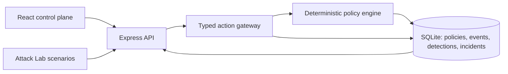

# TrustTrace

TrustTrace is a local-first zero-trust control plane for simulated AI-agent tool calls. It evaluates every action before execution, makes an explicit `ALLOW`, `DENY`, or `REVIEW` decision, records the original policy version and rationale, and turns policy violations into evidence-backed incidents.

## Intended users and problem

Security engineers, platform engineers, and AI application teams need more than suspicious-event logging. TrustTrace demonstrates enforceable least privilege for agent tools, explainable deterministic detections, and an audit trail that survives policy changes. All attack-lab data is synthetic and local.

## Architecture and data flow



An action enters `POST /api/events/evaluate`, is validated, evaluated against enabled policies, and only then is it represented as an audit event. TrustTrace is a monitoring/control-plane prototype; it does not execute the requested tool call.

## Threat model and trust boundaries

- **Untrusted:** synthetic agent metadata, external-content indicators, and Attack Lab requests.
- **Control boundary:** the server-side gateway and policy engine. The browser is never trusted to make a decision.
- **Trusted for this prototype:** local SQLite and the operator running the loopback process.
- **Protected examples:** production resources, synthetic canary secrets, administrative roles, and the policy control plane.
- **Out of scope:** real credentials, real network targets, malware, shell execution, production identity, distributed tamper-evident storage, and multi-user authentication.

## Implemented

- React responsive dashboard with live SQLite-backed metrics, event explorer, incidents, policies, exports, and Attack Lab.
- Typed action gateway with policy matchers for tools/actions, resource scopes, sources, and agents.
- Deny precedence, default review for unmatched actions, persisted historical decisions, and incident lifecycle.
- Deterministic signals for prompt injection, restricted data, unauthorized access, delegation escalation, repeated denials, and policy tampering.
- Seven safe synthetic scenarios: authorized baseline, unauthorized access, prompt injection, data exfiltration, privilege escalation, repeated denials, and policy tampering.
- JSON/CSV exports, report endpoint, validation, security headers, 64 KiB JSON request limit, and loopback default binding.

## Not implemented

This MVP intentionally omits real tool execution, authentication/authorization for multiple operators, remote agents, cryptographic/WORM audit storage, external alerting, and an LLM security decision path. SQLite is append-only by application convention, not tamper-proof: a user with filesystem access can alter it.

## Quick start

Requirements: Node.js 22 (pinned by `.nvmrc`).

```sh
npm ci
npm run build:all
npm test
npm start
```

Open `http://127.0.0.1:8787`. The backend serves `dist-web` when it exists. For hot reload, use two terminals: `npm run dev` and `npm run dev:web`, then open `http://127.0.0.1:5173`.

The application creates `data/trusttrace.db`, seeds deterministic policies and three synthetic baseline events, and keeps later events. Set `TRUSTTRACE_DB_PATH` to choose another local path. Copy `.env.example` to `.env` if desired. No API key is needed.

### Docker

```sh
docker build -t trusttrace:local .
docker run --rm -p 127.0.0.1:8787:8787 -v trusttrace-data:/app/data trusttrace:local
curl http://127.0.0.1:8787/api/health
```

The container defaults to loopback inside the process. The published port is also explicitly bound to loopback. Do not set `TRUSTTRACE_HOST=0.0.0.0` unless you understand the exposure warning and add authentication/network controls outside this prototype.

## Attack Lab walkthrough

1. Start the app and open **Attack Lab**.
2. Run **Authorized baseline** and observe `ALLOW`, low risk, and no incident.
3. Run **Prompt injection**, **Restricted secret access**, or **Policy tampering**. Observe that the synthetic indicator is evidence, but the deterministic policy still makes the enforcement decision.
4. Open **Incidents**, acknowledge one, add a resolution note, and resolve it.
5. Use **Events** to filter decisions and download JSON or CSV. Reset only after confirming; reset clears operational demo events and reseeds the baseline.

Expected decisions are shown next to actual server responses. A `REVIEW` action is not considered executed; this prototype records it as held for analyst review.

## API and project structure

- `src/types.ts` — action, policy, evaluation, and event types.
- `src/policy.ts` — deterministic matching and deny precedence.
- `src/gateway.ts` — central pre-execution gateway, audit writes, and detections.
- `src/db.ts` — SQLite schema and deterministic seed policies.
- `src/server.ts` — validated REST API and static frontend serving.
- `web/` — React/Vite UI.
- `test/api.test.ts` — persistence, policy, incident, export, validation, and lab contract tests.

Important routes: `GET /api/health`, `/api/summary`, `/api/events`, `/api/incidents`, `/api/policies`, `/api/report`, `POST /api/events/evaluate`, `POST /api/lab/:scenario/run`, `POST /api/lab/reset`, and `/api/export/events` or `/api/export/incidents`.

## Reproducibility and checks

The runtime and dependencies are pinned by `.nvmrc` and `package-lock.json`; `Dockerfile` installs the system/runtime dependencies without global packages. The offline test command is:

```sh
make test
```

Additional checks are `npm run format:check`, `npm run typecheck`, `npm run typecheck:web`, and `npm run build:all`.

## Troubleshooting

- **Port in use:** run `PORT=8790 npm start` and use that port in the browser.
- **Database locked:** stop other local TrustTrace processes, or choose a fresh `TRUSTTRACE_DB_PATH`.
- **Blank UI:** run `npm run build:web` or use the Vite dev server.
- **Docker unavailable:** run the Node checks locally; Docker verification requires a Docker daemon.
- **Need a clean demo:** stop the app, remove only the local `data/trusttrace.db*` files, and restart, or use the confirmed Attack Lab reset.

See [SECURITY.md](SECURITY.md) and [ADR-001.md](ADR-001.md) for security reporting and stack decisions.
